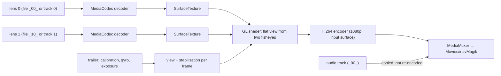

# Plan: .insv → reframed MP4 on the phone

**Goal:** an Android app (public, AGPL-3.0, APK from the GitHub releases). Pick the `.insv` file(s) of one 360° clip, choose where to look,
export a normal flat **1080p MP4** to the gallery, ready for any video editor. No Insta360 app, no PC.
Public since stage 5, with testers.

**Not the goal:** Insta360-app quality (optical-flow stitching, colour matching between lenses),
360° output, photos (`.insp`), log/HDR colour, timelapse, bullet time.

Format details: [insv-format.md](insv-format.md). Sample cameras: Insta360 ONE X2 (two files per
clip, 2 × 2880² H.264), Antigravity A1 drone (one file, 2 × 3840² H.264) and Insta360 X5 (one
file, 2 × 3840² HEVC).

## How the converter works

- **Decode:** one `MediaExtractor` + hardware `MediaCodec` per lens, each into a `SurfaceTexture`
  (OES texture) in one EGL context. For the A1 both extractors open the same file and select
  different tracks. Frames are paired by presentation time.
- **Shader:** for every output pixel: the direction it looks at (view yaw/pitch/roll and field of
  view) → rotated by the stabilisation for that frame's time → the lens that sees it → that lens's
  fisheye position (from the calibration) → sample. Where both lenses see it, blend by distance to
  each lens's edge. About 2 million pixels per frame: cheap on any GPU.
- **Encode:** `MediaCodec` H.264 at 1920×1080 (or 1080×1920), ~16 Mbit/s, the source frame rate;
  the source timestamps go through unchanged. Audio samples are copied as they are.
- **Why not Media3 Transformer:** it handles one input stream per sequence;
  combining two decoded streams into one frame needs its experimental multi-input compositor.
  A direct `MediaCodec` + GL pipeline is a few hundred lines and fully under our control.
- **Structure:** `insv/` (file format, pure Kotlin, unit-tested on the
  PC), `media/` (decode, render, encode), `ui/` (Compose), one activity.

## Will it run on slower phones?

The GPU and the 1080p encoder are never the problem. **Decoding is**, and it's measured, not
guessed: stage 0 asks the phone's decoders and runs a real decode test.

| Clip | Pixels to decode per second | Comparable to | Expect |
|---|---|---|---|
| ONE X2 5.7K | 2 × 2880² × 30 = 0.50 G | 4K at 60 fps | mid-range and up; many decoders cap height at 2160–2304, below 2880 |
| A1 8K | 2 × 3840² × 30 = 0.88 G | close to 8K at 30 fps | flagships with 8K decoding |
| 4K-class modes / `.lrv` proxies | much less | 1080p–4K at 30 fps | nearly every phone |

**Measured** (stage 0 decode test, all streams decoded together into GPU surfaces):

| Phone | Clip | Streams | Per stream | Pace | Decoder |
|---|---|---|---|---|---|
| Pixel 8 (Tensor G3, Android 17) | A1 8K, 2 × 3840² | 2 | 41.7 fps | **1.38×** real time | `c2.exynos.h264.decoder` |
| Pixel 8 | ONE X2 5.7K, 2880² | 1 (lens 0 only; `_10_` not in hand) | 68.3 fps | **2.26×** | same |
| Pixel 8 | X5 8K, 2 × 3840² **HEVC**, 25 fps | 2 | 30.0 fps | **1.19×** | `c2.exynos.hevc.decoder` (declared "no" again) |

The Pixel 8's decoder sustains about 1.2 Gpx/s, so both X2 lenses together should still be about
2× real time (estimate until the pair is tested). Its **declared** performance points said "no"
for the A1's two streams, yet they run 1.38× real time: declared ratings are conservative for
parallel streams, so the speed test decides, not the declared numbers. Still missing: a slower
phone.

Export doesn't have to keep up with real time: a phone that decodes at half speed takes 2 minutes
per minute of video. Only a decoder that refuses the size stops it; then the fallback is the
`.lrv` proxy (much softer). Hardware decoders can't decode at a lower resolution.

A 1080p view out of a 5.7K 360° frame already uses about all the detail the camera has, so 1080p
output is the right target; 4K output would only add file size.

## Stages

Each stage ends with something to try on a phone.

### 0. Probe (built; measured on a Pixel 8)

Pick the clip's files (the system picker with `*/*`, since Android has no MIME type for `.insv`).
Report: the phone and its chip; tracks; camera, firmware, calibration, gyro and exposure from the
trailer; whether the two lenses are both picked; each decoder's limits for this size and rate;
a **decode test** that decodes all lens streams together for 10 s into GPU surfaces and gives the
pace (× real time). **Copy** puts the report on the clipboard, to paste into a chat or an issue.

*Done when:* the report from your phone and from the slowest phone you want to support, for both
cameras, is in hand. That decides whether stage 2 needs the proxy fallback. Pixel 8: done for
both cameras (above); a slower phone and the X2's lens pair are still to test.

### 1. One reframed frame (done for the A1)

Decode one frame of each lens at a chosen time, render the flat view to a bitmap, show it. Sliders
for view yaw, pitch, roll and field of view, a **Sphere** view of the whole panorama, plus debug
sliders for small lens-1 rotation tweaks and the blend width, and a **seam match** number (how
well the lenses agree in their overlap) to line the seam up by number rather than by eye.

How it turned out: the camera's own **XI calibration** works from the start, so stage 1 skipped
the equidistant guess and uses the real lens model (stage 3's main step). The axis conventions
were found on the PC by trying every reading of the angles on the A1 frames (details in
[insv-format.md](insv-format.md)); the A1 renders level with no visible seam on distant scenery.
The maths is plain Kotlin (`view/`), tested on the PC with real frames (`SampleRenderTest`), and
becomes the GL shader in stage 2. On the phone it renders on the CPU: preview only.

*Done when:* distant scenery (horizon, landing field) shows no visible seam on both samples.
A1: done (PC 0.76, Pixel 8 0.78 seam match). ONE X2: needs the `_10_` file.

### 2. Export a fixed view (done)

The full pipeline above with one fixed view, a progress bar, cancel, the screen kept on. Output
to `Movies/insvMagik/<clip>_flat.mp4`. Then the speed is known for real on each phone.

Built as `media/Exporter.kt` (decoders, pairing by timestamp, encoder, muxer, audio copy) and
`media/GlReframer.kt` (EGL + the fragment shader, a port of `view/Reframer`). **Export this view**
on the Frame tab uses the current yaw, pitch, roll, field of view and lens-1 tweak. Only the
phone can test it: the GPU path has no unit test (the shader mirrors the tested CPU maths).

*Done when:* a 1-minute clip exports, plays in the gallery and opens in a video editor; audio in sync.
Done on the Pixel 8 with both samples: every source frame in the output, the source duration,
the X2's audio copied and starting with the video.

### 3. The real lens model

Mostly done in stage 1: the XI shape is the standard omnidirectional model and lines the A1's
seam up. Left: check the ONE X2 pair, decide whether the small lens-1 translation in POLY/XI
(parallax of close objects) is worth using, and whether POLY ever beats XI.

*Done when:* close objects (a hand, the selfie stick's surroundings, the paraglider's lines)
cross the seam with only a small step.

### 4. Stabilisation and level horizon (built; to test on the phone)

Integrate the gyro into an orientation per frame; take "down" from the accelerometer (a
complementary filter) for a level horizon. Two view modes: **locked** (the view stays pointed at
the same place in the world) and **follow** (the view turns with the camera's smoothed heading,
like the Insta360 app's default). Rolling-shutter correction only if the result wobbles.

How it turned out (details in [insv-format.md](insv-format.md), "Motion"):
- **Clock:** no need to search the exposure list: the camera info says when frame 0 was taken on
  the gyro's clock (field 24) plus a small offset (field 28), as telemetry-parser reads them.
  Checked on the X2 clip: shifting the gyro by ±5 ms only makes it worse.
- **Units:** the A1's raw counts scale by the sensor ranges in field 65 (± 32 g, ± 2000 °/s);
  at rest the accelerometer reads 0.996 g.
- **Axes:** where the sensor sits in the rig's body axes is per camera model (`SensorAxes`). ONE
  X2: found from its video, by stabilising with all 24 axis-to-axis turns and keeping the one that
  holds the background stillest (half the frame-to-frame change of no stabilisation; the next
  best turn is clearly worse). A1: its sample doesn't move, so only gravity tells: the turn that
  levels the horizon (the drone sits ~10° tilted on the table, so the calibration's own "world"
  is the drone body, not level). The A1's gyro axes are assumed to be the accelerometer's. X5:
  from a motorbike ride, the turn that keeps the sun fixed in a locked world (and levels the
  horizon through the curves).
- **Resting gyro offset:** measured from every still half second (the A1 drifts ~0.25 °/s
  otherwise); a handheld clip that never rests keeps it.
- Built as `motion/` (pure Kotlin, unit-tested; `SampleMotionTest` checks the X2 axes and clock
  on its frames): `ImuTrack` (axes, units, clock), `Attitude` (the filter), `Stabilizer`
  (follow / locked per frame time). The renderer and the export shader take one extra rotation
  per frame, so the shader didn't change. The Frame tab has **Motion: Off / Follow / Locked**;
  the export uses the choice (`…_follow.mp4`, `…_locked.mp4`, `…_flat.mp4`).
- Other cameras get "no stabilisation yet" until their axes are measured; the yaw of Locked
  drifts slowly (no compass), Follow doesn't care.

*Done when:* a walking or flying clip looks steady with a level horizon in both modes. Needs a
moving A1 clip (to confirm its gyro axes) and a longer walking clip. A leaning motorbike is the
hard case for the horizon: in a long curve the accelerometer reads the bike's own "down", so the
filter trusts it less the further it is from 1 g.

### 5. Moving the view (built; to test on the phone)

Keyframes along the clip (direction and zoom at a few moments, smooth in between), 9:16 output,
the `.lrv` fallback, more cameras (X3, X4) as samples arrive.

Built so far:
- **Keyframes** (`view/Keyframes.kt`, `ViewPath`): yaw, pitch, roll and field of view at chosen
  moments; the clip starts with the starting view (the one set without keyframes, unless a
  keyframe sits at 0 s), moves through the keyframes and holds the last; each value follows a
  monotone cubic (Fritsch–Carlson): it eases in and out and never overshoots a keyframe, so a
  pan stops where it was set. Yaw takes the short way round. Keyframes live in the stabilised
  world, so Follow / Locked still apply underneath. Unit-tested (`ViewPathTest`).
- On the tab: **◇ Keyframe here** adds one on the frame on screen (or removes it); once there
  are keyframes, moving a slider sets the view at this frame (adding a keyframe if needed);
  the keyframe chips jump to their frames; **Clear all** goes back to one fixed view.
- **Output shape:** 16:9 (1920×1080), 9:16 (1080×1920), 1:1 (1080×1080); the field of view spans
  the longer side, so switching shape keeps the framing comparable. Files get `_9x16` / `_1x1`.
- For testers: the tabs are **Files** and **View & export**; the seam tools fold away.

Still to do: the `.lrv` fallback for phones that can't decode the full size, keyframes saved
with the clip (they live only while the app is open), more cameras.

## Open questions

1. **A1 gyro values:** answered: ranges from field 65, axes from gravity (stage 4). Still to
   confirm with a clip where the drone moves.
2. **Frame ↔ gyro time:** answered: camera-info fields 24 and 28 (stage 4). On the A1 the
   exposure entry at that time is entry 8 of 287.
3. **The ONE X2's `_10_` file:** does it carry its own trailer, or only `_00_`? Needs the pair.
4. **Lens model meaning:** XI is answered (omnidirectional model, `k1 k2 k3 p1 p2`, rotation
   convention found; insv-format.md). POLY and the BASIC angle convention are still unknown;
   not needed while every camera writes XI.
5. **The A1's `text` track and its extra records:** telemetry, GPS? Possibly useful for "follow".
6. **Getting `.insv` onto the phone:** the Insta360 app keeps its downloads to itself (probably);
   USB mass-storage mode of the camera, a card reader on USB-C, or copying through a PC work. To
   check per camera, including how the A1's files come off the drone.
7. **Official SDK:** Insta360 offers SDKs on application. If the Android one stitches and its terms
   allow it, stages 3–4 could use it instead. Not needed to start.

## Working rules

- Samples never go in the repo. Unit tests that need them read the folder in `INSV_SAMPLES`
  and skip without it.
- The APK is published only through `release.yml` (signed with the release key), never by hand;
  testers follow `docs/tester-guide.md`. No Insta360 or Antigravity branding in the app; "for
  .insv files" is fine.
- No code copied from GPL projects (Gyroflow's app); telemetry-parser is MIT/Apache-2.0 and may be
  read and ported with attribution.
