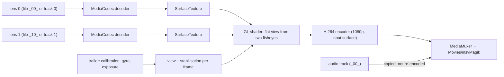

# Plan: .insv → reframed MP4 on the phone

**Goal:** an internal Android APK. Pick the `.insv` file(s) of one 360° clip, choose where to look,
export a normal flat **1080p MP4** to the gallery, ready for mobiCut. No Insta360 app, no PC.
Private for now; public later if it works well. If it proves itself, the converter may move into
mobiCut.

**Not the goal:** Insta360-app quality (optical-flow stitching, colour matching between lenses),
360° output, photos (`.insp`), log/HDR colour, timelapse, bullet time.

Format details: [insv-format.md](insv-format.md). Sample cameras: Insta360 ONE X2 (two files per
clip, 2 × 2880² H.264) and Antigravity A1 drone (one file, 2 × 3840² H.264).

## How the converter works

- **Decode:** one `MediaExtractor` + hardware `MediaCodec` per lens, each into a `SurfaceTexture`
  (OES texture) in one EGL context. For the A1 both extractors open the same file and select
  different tracks. Frames are paired by presentation time.
- **Shader:** for every output pixel: the direction it looks at (view yaw/pitch/roll and field of
  view) → rotated by the stabilisation for that frame's time → the lens that sees it → that lens's
  fisheye position (from the calibration) → sample. Where both lenses see it, blend by distance to
  each lens's edge. About 2 million pixels per frame: cheap on any GPU.
- **Encode:** `MediaCodec` H.264 at 1920×1080 (or 1080×1920), ~16 Mbit/s, the source frame rate;
  the source timestamps go through unchanged. Audio samples are copied as they are.
- **Why not Media3 Transformer** (mobiCut's exporter): it handles one input stream per sequence;
  combining two decoded streams into one frame needs its experimental multi-input compositor.
  A direct `MediaCodec` + GL pipeline is a few hundred lines and fully under our control. The
  shader could later become a mobiCut `GlEffect`.
- **Structure:** like mobiCut but smaller: `insv/` (file format, pure Kotlin, unit-tested on the
  PC), `media/` (decode, render, encode), `ui/` (Compose), one activity.

## Will it run on slower phones?

The GPU and the 1080p encoder are never the problem. **Decoding is**, and it's measured, not
guessed: stage 0 asks the phone's decoders and runs a real decode test.

| Clip | Pixels to decode per second | Comparable to | Expect |
|---|---|---|---|
| ONE X2 5.7K | 2 × 2880² × 30 = 0.50 G | 4K at 60 fps | mid-range and up; many decoders cap height at 2160–2304, below 2880 |
| A1 8K | 2 × 3840² × 30 = 0.88 G | close to 8K at 30 fps | flagships with 8K decoding |
| 4K-class modes / `.lrv` proxies | much less | 1080p–4K at 30 fps | nearly every phone |

Export doesn't have to keep up with real time: a phone that decodes at half speed takes 2 minutes
per minute of video. Only a decoder that refuses the size stops it; then the fallback is the
`.lrv` proxy (much softer). Hardware decoders can't decode at a lower resolution.

A 1080p view out of a 5.7K 360° frame already uses about all the detail the camera has, so 1080p
output is the right target; 4K output would only add file size.

## Stages

Each stage ends with something to try on a phone.

### 0. Probe (done in this first version)

Pick the clip's files (the system picker with `*/*`, since Android has no MIME type for `.insv`).
Report: the phone and its chip; tracks; camera, firmware, calibration, gyro and exposure from the
trailer; whether the two lenses are both picked; each decoder's limits for this size and rate;
a **decode test** that decodes all lens streams together for 10 s into GPU surfaces and gives the
pace (× real time). **Copy** puts the report on the clipboard, to paste into a chat or an issue.

*Done when:* the report from your phone and from the slowest phone you want to support, for both
cameras, is in hand. That decides whether stage 2 needs the proxy fallback.

### 1. One reframed frame

Decode one frame of each lens at a chosen time, render the flat view to a bitmap, show it. Sliders
for view yaw, pitch and field of view, plus debug sliders for the lens model (field of view of
the fisheye, small per-lens rotation tweaks) to line the seam up by eye. Start with the BASIC
calibration (radius, centre, rotation) and an equidistant fisheye model.

*Done when:* distant scenery (horizon, landing field) shows no visible seam on both samples.

### 2. Export a fixed view

The full pipeline above with one fixed view, a progress bar, cancel, the screen kept on. Output
to `Movies/insvMagik/<clip>.mp4`. Then the speed is known for real on each phone.

*Done when:* a 1-minute clip exports, plays in the gallery and opens in mobiCut; audio in sync.

### 3. The real lens model

Use the full calibration instead of tuned guesses: try the XI shape first (it looks like a
standard model with known maths), then POLY; keep whichever lines the seam up best, per camera.

*Done when:* close objects (a hand, the selfie stick's surroundings, the paraglider's lines)
cross the seam with only a small step.

### 4. Stabilisation and level horizon

Integrate the gyro into an orientation per frame; take "down" from the accelerometer (low-pass,
complementary filter) for a level horizon. Match frames to gyro time through the exposure list
(find which entry is frame 0: the lists are longer than the video). Two view modes: **locked**
(the view stays pointed at the same place in the world) and **follow** (the view turns with the
camera's smoothed heading, like the Insta360 app's default). Rolling-shutter correction only if
the result wobbles.

*Done when:* a walking or flying clip looks steady with a level horizon in both modes.

### 5. Moving the view (later)

Keyframes along the clip (direction and zoom at a few moments, smooth in between), 9:16 output,
the `.lrv` fallback, more cameras (X3, X4, X5) as samples arrive.

## Open questions

1. **A1 gyro values:** 16-bit counts with an unknown scale and axis order. Check telemetry-parser
   (MIT/Apache-2.0) for Insta360's scales; otherwise calibrate: the accelerometer reads 1 g at
   rest, and the gyro must match the motion seen in the video.
2. **Frame ↔ exposure entry:** which of the longer exposure list is frame 0 (X2: 130 entries for
   115 frames; A1: 287 for 269).
3. **The ONE X2's `_10_` file:** does it carry its own trailer, or only `_00_`? Needs the pair.
4. **Lens model meaning:** what the POLY and XI numbers are exactly, and which the Insta360 app uses.
5. **The A1's `text` track and its extra records:** telemetry, GPS? Possibly useful for "follow".
6. **Getting `.insv` onto the phone:** the Insta360 app keeps its downloads to itself (probably);
   USB mass-storage mode of the camera, a card reader on USB-C, or copying through a PC work. To
   check per camera, including how the A1's files come off the drone.
7. **Official SDK:** Insta360 offers SDKs on application. If the Android one stitches and its terms
   allow it, stages 3–4 could use it instead. Not needed to start.

## Working rules

- Samples never go in the repo. Unit tests that need them read the folder in `INSV_SAMPLES`
  and skip without it.
- The APK is internal: built locally (`tools/install.ps1`), not published, until the repo goes
  public. No Insta360 or Antigravity branding in the app; "for .insv files" is fine.
- No code copied from GPL projects (Gyroflow's app); telemetry-parser is MIT/Apache-2.0 and may be
  read and ported with attribution.
